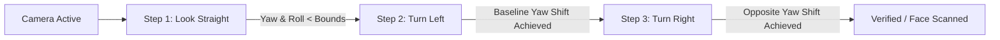

# 👤 FaceLogin & Face Accessories Studio

A modern, privacy-first biometric authentication web application powered by **Flask** and **OpenCV** deep neural networks (**YuNet** for 5-landmark face detection and **SFace** for 128-dimensional biometric embedding). Includes dynamic multi-stage anti-spoofing liveness verification and a real-time interactive **AR Face Accessories Studio**.

---

## 📑 Table of Contents
- [✨ Key Features](#-key-features)
- [🔒 Privacy & Security Architecture](#-privacy--security-architecture)
- [🎭 Multi-Stage Liveness Verification](#-multi-stage-liveness-verification)
- [🎨 Face Accessories Studio (AR Filters)](#-face-accessories-studio-ar-filters)
- [📁 Project Structure](#-project-structure)
- [🚀 Quick Start (Local Setup)](#-quick-start-local-setup)
- [📡 API & Endpoints](#-api--endpoints)
- [⚙️ Configuration & Threshold Tuning](#️-configuration--threshold-tuning)
- [🐳 Production & Docker Deployment](#-production--docker-deployment)
- [❓ Troubleshooting & FAQs](#-troubleshooting--faqs)

---

## ✨ Key Features

- **Passwordless Biometric Login**: Fast 1:N face identification and 1:1 user verification using deep metric embeddings with cosine similarity.
- **Privacy-by-Design**: **Zero photos or raw video frames are ever saved**. Face images are converted in-memory to 128-float embedding vectors and immediately discarded.
- **Dynamic 3-Step Anti-Spoofing Liveness Detection**:
  1. **Look Straight**: Validates neutral frontal face orientation (yaw and roll within strict tolerances).
  2. **Turn Left**: Prompts for horizontal head rotation to the left compared against a baseline to ensure real 3D head movement.
  3. **Turn Right**: Prompts for horizontal head rotation to the right, verifying opposite-direction movement for stronger anti-spoofing.
- **Live Face Accessories Studio**:
  - Interactive AR canvas overlay applied in real time to the live webcam feed.
  - Automatically compensates for mirror reflections and head rotation angles.
  - Anatomically calibrated anchor points for hats, crowns, and bunny ears to sit naturally atop the head rather than across the forehead.
  - Custom size scaling, vertical height fine-tuning, and one-click snapshot capture.
- **Responsive Dark Theme UI**: Built with accessible semantic HTML5, pure CSS custom properties, and zero bloated frontend frameworks.

---

## 🔒 Privacy & Security Architecture

Traditional face-recognition systems pose high privacy risks by storing user photos in a database or cloud bucket. **FaceLogin** enforces strict privacy guarantees:

```
[Webcam Stream] ──(Canvas Frame)──> [YuNet Detector (In-Memory)]
                                             │
                                    (5 Facial Landmarks)
                                             │
                                     [SFace Recognizer]
                                             │
                                  (128-D Embedding Vector)
                                             │
                   ┌─────────────────────────┴────────────────────────┐
                   ▼                                                  ▼
      [Registration / Storage]                             [Authentication Check]
  Binary blob written to SQLite (`faces.db`)        Cosine similarity vs. stored prints
  (Photos permanently discarded)                    Threshold: match >= 0.363
```

- **Ephemeral In-Memory Processing**: Uploaded frames (base64-encoded JPEG) are decoded directly into NumPy arrays in RAM and wiped on garbage collection.
- **One-Way Biometric Templates**: Stored records in `faces.db` are raw 128-element `float32` arrays (512 bytes). A face image cannot be reverse-engineered or reconstructed from an embedding vector.
- **Rate-Limiting & Session Isolation**: In-memory rate limiting throttles brute-force attempts per IP. Authenticated sessions use cryptographically signed HTTP-only cookies with configurable `SameSite` and `Secure` attributes.

---

## 🎭 Multi-Stage Liveness Verification

To prevent presentation attacks (e.g. holding a printed photo, smartphone screen, or pre-recorded video in front of the lens), the authentication and registration flows enforce a dynamic interactive challenge:



1. **Step 1 — Neutral Frontal Scan (`STRAIGHT_MAX_DEG = 3.0°`, `STRAIGHT_MAX_YAW = 0.035`)**:
   - Compares eye slope for roll angle and nose position relative to the eye axis for yaw angle.
2. **Step 2 — Turn Left (`YAW_MIN = 0.045`, `TILT_MIN_DEG = 4.0°`)**:
   - Always asks the user to turn their head to the left.
   - Evaluates the nose-to-eye axis projection delta against the initial baseline.
   - Visual progress bar fills as the turn is achieved before transitioning.
3. **Step 3 — Turn Right (`YAW_MIN = 0.045`, `TILT_MIN_DEG = 4.0°`)**:
   - After returning to center, asks the user to turn their head to the right.
   - Verifies the opposite-direction head rotation using the same threshold logic, confirming real 3D movement.

---

## 🎨 Face Accessories Studio (AR Filters)

The user dashboard includes an interactive accessories studio that tracks facial landmarks in real time:

| Accessory | Icon | Placement & Behavior |
|---|:---:|---|
| **Sunglasses** | 🕶️ | Auto-scales across eye span; tracks eye roll angle |
| **Royal Crown** | 👑 | Sits on top of the head crown with golden jewels |
| **Top Hat** | 🎩 | Formal top hat with custom brim and ribbon band |
| **Moustache** | 🥸 | Aligns under nose tip above mouth line |
| **Cyber Visor** | 🤖 | Neon cybernetic glowing visor with circuit accents |
| **Cat Ears** | 🐱 | Dual triangular ears with inner pink accents |
| **Bunny Ears** | 🐰 | Tall upright bunny ears tracking head tilt |
| **Carnival Mask**| 🎭 | Masquerade winged eye mask with glitter ornaments |

### Key Studio Controls:
- **Size Scale Slider (70% – 140%)**: Adjust accessory scale relative to detected face dimensions.
- **Head Height Adjustment (-50px to +50px)**: Fine-tune the vertical offset to accommodate different hair volumes and forehead heights.
- **Multi-Select Combine**: Toggle multiple accessories simultaneously (e.g. Top Hat + Sunglasses + Moustache).
- **📸 Capture Snapshot**: Instantly downloads a high-resolution PNG snapshot with applied AR overlays.

---

## 📁 Project Structure

```
face-login/
├── app.py                      # Core Flask web server, route handlers & authentication logic
├── face_utils.py               # OpenCV YuNet & SFace wrappers, landmark math & liveness analysis
├── requirements.txt            # Python dependencies (Flask, OpenCV headless, NumPy, Gunicorn)
├── Dockerfile                  # Container build recipe for production deployment
├── README.md                   # Complete system documentation
│
├── models/
│   ├── download_models.py      # Automated script to fetch ONNX model weights
│   ├── face_detection_yunet_2023mar.onnx
│   └── face_recognition_sface_2021dec.onnx
│
├── instance/
│   └── faces.db                # SQLite database storing user credentials & 128D embeddings
│
├── templates/
│   ├── base.html               # Base layout, shared meta tags, headers and notifications
│   ├── login.html              # Biometric login interface with challenge viewfinder
│   ├── register.html           # Biometric user onboarding with username & face scan
│   ├── dashboard.html          # User profile, face studio AR canvas, and account deletion
│   └── _viewfinder.html        # Reusable camera viewfinder component with liveness steps
│
└── static/
    ├── app.js                  # Frontend camera loop, landmark tracker, AR renderer & API client
    └── style.css               # Clean modern dark theme stylesheet with custom UI controls
```

---

## 🚀 Quick Start (Local Setup)

### 1. Prerequisites
- **Python 3.10+** (Python 3.11 or 3.12 recommended; 3.13 supported)
- Modern web browser (Chrome, Edge, Firefox, or Safari)
- Built-in webcam or USB camera

### 2. Clone & Environment Setup

#### Windows (PowerShell):
```powershell
# Navigate to the folder
cd C:\Users\USER\Desktop\face-login

# Create virtual environment
python -m venv venv

# Activate virtual environment
.\venv\Scripts\Activate.ps1

# Install required packages
pip install -r requirements.txt
```

#### macOS / Linux:
```bash
python3 -m venv venv
source venv/bin/activate
pip install -r requirements.txt
```

### 3. Download ONNX Neural Network Models
The application relies on official OpenCV Zoo ONNX models. Run the included downloader:
```bash
python models/download_models.py
```
This fetches:
- `face_detection_yunet_2023mar.onnx` (~336 KB)
- `face_recognition_sface_2021dec.onnx` (~37.5 MB)

### 4. Start the Application
```bash
python app.py
```
Open your browser and navigate to:
```
http://localhost:5000
```

> **Note on Webcam Permissions:** Modern browsers permit webcam access on `http://localhost` without SSL. For remote network testing, an **HTTPS** connection is mandatory.

---

## 📡 API & Endpoints

| Method | Endpoint | Description | Payload / Parameters |
|---|---|---|---|
| `GET` | `/` | Root redirect to login or dashboard | - |
| `GET` | `/register` | User registration page | - |
| `GET` | `/login` | Biometric login page | - |
| `GET` | `/dashboard` | User dashboard & Face Accessories Studio | Session Cookie required |
| `POST` | `/api/challenge` | Generate anti-spoofing challenge token | `None` -> `{token}` |
| `POST` | `/api/verify_pose` | Validate real-time pose (yaw / roll / direction) | `{token, step, frame, direction, baseline_yaw, baseline_roll}` |
| `POST` | `/api/register` | Register new user with liveness verification | `{username, token, straight, turn_left, turn_right}` |
| `POST` | `/api/login` | Biometric sign-in using face embedding match | `{token, straight, turn_left, turn_right}` |
| `POST` | `/api/delete` | Delete account with face re-confirmation | `{token, straight, turn_left, turn_right}` |
| `POST` | `/api/logout` | Invalidate user session | Session Cookie required |
| `POST` | `/api/detect_landmarks` | Fallback face landmark detection for AR studio | `{image: "data:image/jpeg;base64,..."}` |

---

## ⚙️ Configuration & Threshold Tuning

Biometric and liveness thresholds are defined in [face_utils.py](file:///c:/Users/USER/Desktop/face-login/face_utils.py):

| Parameter | Default | Purpose / Tuning Recommendation |
|---|:---:|---|
| `MATCH_THRESHOLD` | `0.363` | SFace cosine similarity cutoff. Higher (`0.40`) = stricter matching; Lower (`0.33`) = more forgiving. |
| `STRAIGHT_MAX_DEG` | `3.0°` | Max allowed head roll when looking straight forward. |
| `STRAIGHT_MAX_YAW` | `0.035` | Max allowed nose-eye horizontal offset for frontal alignment. |
| `YAW_MIN` | `0.045` | Minimum horizontal turn required for the pose step. |
| `TILT_MIN_DEG` | `4.0°` | Fallback angle if user tilts slightly instead of rotating. |

### Environment Variables
Configure these in production:
- `SECRET_KEY`: Long random string for session signing (defaults to dev fallback if not set).
- `SECURE_COOKIES`: Set to `1` in production to enforce `Secure; HttpOnly; SameSite=Lax` cookies.
- `DATABASE_PATH`: Custom path for SQLite database (defaults to `instance/faces.db`).

---

## 🐳 Production & Docker Deployment

A production-ready [Dockerfile](file:///c:/Users/USER/Desktop/face-login/Dockerfile) is included:

```dockerfile
FROM python:3.11-slim
WORKDIR /app
ENV PYTHONUNBUFFERED=1
COPY requirements.txt .
RUN pip install --no-cache-dir -r requirements.txt
COPY . .
RUN python models/download_models.py
ENV SECURE_COOKIES=1 DATABASE_PATH=/data/faces.db
EXPOSE 8000
CMD gunicorn app:app --bind 0.0.0.0:${PORT:-8000} --workers 1 --threads 4 --timeout 60
```

### Build & Run with Docker:
```bash
# 1. Build Docker image
docker build -t face-login .

# 2. Run container with persistent data volume
docker run -d -p 8000:8000 -v face_data:/data -e SECRET_KEY="your-production-secret" face-login
```

### Deploying to Cloud Platforms (Render, Railway, Fly.io):
1. Push this repository to GitHub.
2. In Render / Railway, create a new **Web Service** pointing to the repository (Runtime: **Docker**).
3. Set the environment variable:
   - `SECRET_KEY` = `<secure-random-token>`
4. Add a persistent disk mounted to `/data` so `faces.db` persists across redeployments.
5. Deploy. The platform provides an **HTTPS** URL, enabling webcam permissions automatically.

---

## ❓ Troubleshooting & FAQs

**Q: The camera isn't turning on or shows permission denied.**
- Check browser permissions (click the lock/camera icon in your browser address bar and choose *Allow*).
- When running remotely (e.g. over local LAN IP or cloud), webcam access is blocked by browsers unless accessed via `https://` or `http://localhost`.

**Q: Face scan fails with "No face detected" or "Multiple faces detected".**
- Ensure good, even lighting on your face without strong backlights (e.g. sitting with a bright window behind you).
- Keep only one person in frame during registration and sign-in.
- Position your face inside the circular viewfinder guide.

**Q: Step 2 doesn't register my turn.**
- Turn your head smoothly to the indicated side (left or right).
- Ensure your whole face remains visible within the camera boundary.

**Q: Are my pictures stored anywhere?**
- **No.** Pictures are never stored on disk or in the database. Only 128 numerical values representing facial geometry are preserved.

---

## 📄 License
This project is open-source under the MIT License.
